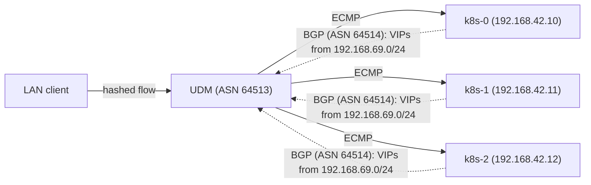
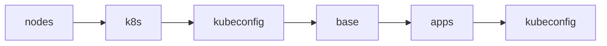

# Bootstrap

This directory takes newly installed Talos nodes to a cluster that Flux
manages. One command runs the full process:

```sh
mise run //bootstrap:cluster
```

After the command completes, Flux reconciles
[`kubernetes/apps/`](../kubernetes/apps/). You do not use this directory again
until the next rebuild.

## Prerequisites

Before you run the command, do these steps:

- Install these tools on the PATH: `mise`, `talosctl`, `minijinja-cli`, `op`,
  `yq`, `jq`, `kubectl`, `helm`, `helmfile`, `kustomize`, `gum` and `curl`.
- Sign in to the 1Password CLI (`op`).
- Put a valid `talosconfig` file at the root of the repository.
- Apply the configuration in the next section to the UDM (the UniFi gateway).

This repository holds no machine secrets. `op inject` resolves each `op://`
reference in the Talos configuration and the bootstrap manifests at apply
time.

mise points `TALOSCONFIG` at the `talosconfig` file. The bootstrap tasks read
the controller endpoint and the node list from `talosctl config info`, so this
directory hardcodes no addresses.

`k8s.internal` points at the Cilium LoadBalancer VIP (virtual IP). This VIP
exists only after the `apps` stage installs Cilium. Until then, bootstrap
connects directly to the first endpoint in `talosconfig`.

## UDM configuration

The Kubernetes API is available through a Cilium LoadBalancer `Service`:
`kube-api` at `192.168.69.120`. The `Service` uses
`externalTrafficPolicy: Local`, so only nodes with a healthy apiserver receive
traffic. Cilium announces this IP and every other LoadBalancer IP to the UDM
over BGP (see
[`kubernetes/apps/kube-system/cilium/app/networking.yaml`](../kubernetes/apps/kube-system/cilium/app/networking.yaml)).



This document uses these VIPs:

| VIP              | Hostname            | Backs                            |
| ---------------- | ------------------- | -------------------------------- |
| `192.168.69.120` | `k8s.internal`      | `kube-api` `Service` (apiserver) |
| `192.168.69.121` | `internal.turbo.ac` | `envoy-internal` `Gateway`       |
| `192.168.69.126` | `external.turbo.ac` | `envoy-external` `Gateway`       |

A static A record in UniFi points the API hostname at the VIP. The record is
in the policy section, and the UI location changes between Network releases:

```text
k8s.internal → 192.168.69.120
```

Cilium (ASN 64514) peers from the node IPs on the SERVERS subnet
(`192.168.42.10-12`). It announces LoadBalancer `Service` IPs from the
`192.168.69.0/24` pool. UniFi accepts one FRR configuration upload for each
device (`Settings → Routing → BGP`):

<details>
<summary>FRR configuration</summary>

```text
router bgp 64513
  bgp router-id 192.168.1.1
  no bgp ebgp-requires-policy

  neighbor k8s peer-group
  neighbor k8s remote-as 64514

  neighbor 192.168.42.10 peer-group k8s
  neighbor 192.168.42.11 peer-group k8s
  neighbor 192.168.42.12 peer-group k8s

  address-family ipv4 unicast
    maximum-paths 3
    neighbor k8s next-hop-self
    neighbor k8s soft-reconfiguration inbound
  exit-address-family
exit
```

</details>

ECMP (equal-cost multipath) spreads traffic over all paths of equal cost.
`maximum-paths 3` permits three ECMP paths for the `kube-api` VIP, one for
each control plane node.

> [!WARNING]
> If you upload the FRR configuration again, the established BGP sessions drop
> for a short time.

Make sure that the BGP configuration works. Run these commands on the UDM:

```sh
vtysh -c "show bgp summary"             # expect: a session for each node
vtysh -c "show ip route"                # expect: one ECMP path for each healthy apiserver on 192.168.69.120/32
vtysh -c "show ip bgp 192.168.69.120"   # expect: the multipath tag on each path
ip route show 192.168.69.120            # expect: one nexthop line for each node
```

In the output of `ip route show`, one flat line means that the kernel did not
install multipath. Then run this command from a LAN client:

```sh
curl -k https://k8s.internal:6443/livez   # expect: ok
```

`k8s.internal` uses the Cilium `kube-api` LoadBalancer. If Cilium is not
healthy, connect directly to the Kubernetes API at
`https://192.168.42.10-12:6443`. Use the same node addresses for the Talos
API. These two APIs do not depend on the CNI (the cluster network plugin, here
Cilium).

## UDM boot scripts

The root filesystem of the UDM is an overlay. Changes in `/etc` stay after a
reboot, but a firmware upgrade removes them. `/run` is tmpfs (a filesystem in
memory), so a reboot clears it. `/data` is a real partition, and its contents
stay after reboots and firmware upgrades.

For this reason, each custom change is a boot script in `/data/on_boot.d`. The
`udm-boot` service from
[unifi-utilities/unifi-common](https://github.com/unifi-utilities/unifi-common)
(UniFi OS 4.x and later) runs these scripts. Install the service on the UDM:

```sh
curl -fsL "https://raw.githubusercontent.com/unifi-utilities/unifi-common/HEAD/remote_install.sh" | /bin/bash
```

> [!WARNING]
> After a firmware upgrade, run `systemctl is-enabled udm-boot` on the UDM. If
> the service is not enabled, run the installer again. The service unit is on
> the overlay, so an upgrade can remove it. The scripts in `/data/on_boot.d`
> stay.

### ECMP flow hashing

The kernel default (`fib_multipath_hash_policy=0`) hashes on the source IP and
the destination IP only. As a result, one client always reaches the same node.
Policy `1` adds the ports to the hash, so separate connections spread across
the ECMP next hops.

`/data/on_boot.d/30-ecmp-l4-hash.sh`:

```sh
#!/bin/sh
echo "net.ipv4.fib_multipath_hash_policy = 1" > /etc/sysctl.d/30-ecmp-l4-hash.conf
sysctl -w net.ipv4.fib_multipath_hash_policy=1
```

The `sysctl.d` drop-in file applies the value after a reboot. The boot script
creates the file again after a firmware upgrade.

Make sure that connections spread across the nodes. Run this command a few
times from one machine. It prints the SAN (subject alternative name) of the
certificate:

```sh
openssl s_client -connect k8s.internal:6443 </dev/null 2>/dev/null \
  | openssl x509 -noout -ext subjectAltName   # expect: different node names across the runs
```

### HTTP/3 discovery

Envoy Gateway serves HTTP/3. The `ClientTrafficPolicy` sets `http3: {}`, and
both LoadBalancer `Service` resources listen on UDP 443. Without an HTTPS
(type 65) record in DNS, a browser finds HTTP/3 only after a first TCP visit,
through the `Alt-Svc` header. dnsmasq on the UDM can publish these records for
the gateway hostnames. The hex payload decodes to priority 1, target `.`,
`alpn="h3,h2"`.

App hostnames that the UDM resolves to a gateway are CNAME records to the
gateway hostname. dnsmasq follows the CNAME, so these hostnames need no HTTPS
records of their own. This includes the apps behind the Cloudflare tunnel, for
example `plex`.

The main dnsmasq instance loads `--conf-dir=/run/dnsmasq.dhcp.conf.d/`. This
directory is on tmpfs, and `ubios-udapi-server` generates it again. A second
boot script writes the records.

`/data/on_boot.d/40-dnsmasq-https-rr.sh`:

```sh
#!/bin/sh
CONF_DIR=/run/dnsmasq.dhcp.conf.d
for i in $(seq 1 30); do [ -d "$CONF_DIR" ] && break; sleep 2; done
[ -d "$CONF_DIR" ] || exit 0
cat > "$CONF_DIR/custom.conf" <<RR
dns-rr=external.turbo.ac,65,00010000010006026833026832
dns-rr=internal.turbo.ac,65,00010000010006026833026832
RR
[ -f /run/dnsmasq-main.pid ] && kill "$(cat /run/dnsmasq-main.pid)" 2>/dev/null
exit 0
```

The script stops the main dnsmasq process. This is safe, because
`ubios-udapi-server` starts dnsmasq again with the new configuration.

> [!NOTE]
> A provisioning event in the Network app can generate the directory again.
> `custom.conf` is then absent until the next reboot, or until the script runs
> again.

Make sure that the UDM serves the records and that HTTP/3 works. Run these
commands from a LAN client:

```sh
dig +short @192.168.1.1 internal.turbo.ac HTTPS   # expect: 1 . alpn="h3,h2"
curl --http3-only -sk -o /dev/null -w '%{http_version}\n' https://internal.turbo.ac/   # expect: 3
```

## Stages

`mise run //bootstrap:cluster` runs these stages in order (see
[`mise.toml`](mise.toml)):



1. The `nodes` stage renders the Talos configuration of each node from the
   templates in [`talos/`](../talos/) and injects the 1Password secrets. It
   applies the configuration with `talosctl apply-config --insecure`. The
   stage skips nodes that already have a configuration.

2. The `k8s` stage runs `talosctl bootstrap` on the first endpoint in
   `talosconfig`. It tries again every 5 seconds until Talos answers
   `AlreadyExists`.

3. The `kubeconfig` stage fetches the kubeconfig with `talosctl kubeconfig`.
   It then sets the server address to the first endpoint in `talosconfig`. The
   generated address `https://k8s.internal:6443` points at the Cilium VIP, and
   this VIP does not exist until the `apps` stage installs Cilium.

4. The `base` stage waits until the apiserver on each node answers `/readyz`.
   It then waits until each node that Kubernetes lists reports a `Ready`
   condition. Nodes stay `Ready=False` until the `apps` stage installs the
   CNI. The stage then applies the bootstrap `Secret` resources and the CRDs.

    [`kustomize/personal/`](kustomize/personal/) holds the bootstrap `Secret`
    resources and their namespaces: the 1Password Connect credentials, the
    1Password Connect token and the Cloudflare tunnel ID. `op inject` fills in
    the secret values. Each `Secret` exists before its controller starts, so
    no controller waits for a `Secret` that is missing.

    [`helmfile/crds.yaml`](helmfile/crds.yaml) lists the charts that supply
    the CRDs: `envoy-gateway`, `grafana-operator`, `kopiur`,
    `kube-prometheus-stack` and `snapshot-controller`. The stage renders the
    CRDs from these charts and applies them with `kubectl`. As a result, Flux
    `Kustomization` resources need no `dependsOn` entry to wait for these
    CRDs.

5. The `apps` stage runs `helmfile sync` on
   [`helmfile/apps.yaml`](helmfile/apps.yaml). These releases are the minimum
   that Flux needs before it can manage the cluster:

    ```text
    cilium → coredns → spegel → cert-manager → external-secrets →
    onepassword-connect → flux-operator → flux-instance
    ```

    After `flux-instance` is healthy, Flux reconciles
    [`kubernetes/apps/`](../kubernetes/apps/) and manages these same releases.

6. The `kubeconfig` stage runs a second time and fetches the kubeconfig again.
   The server address is then `https://k8s.internal:6443`, because Cilium now
   serves the VIP.

You can run each stage again safely. If bootstrap fails, correct the cause.
Then run `mise run //bootstrap:cluster` again.

## Data restore (Kopiur)

Bootstrap restores no application data.
[Kopiur](https://github.com/home-operations/kopiur) restores the data after
Flux takes control. Flux deploys Kopiur from
[`kubernetes/apps/kopiur-system/`](../kubernetes/apps/kopiur-system/). Kopiur
uses the `expanse` `ClusterRepository`, which is a kopia repository in S3 on
`expanse.internal`.

Apps that use the `kopiur/backup` component get a PVC (see
[`kubernetes/components/kopiur/backup/`](../kubernetes/components/kopiur/backup/)).
The `spec.dataSourceRef` of this PVC points at a Kopiur `Restore` with
`target.populator: {}`. This configuration makes the `Restore` a passive
volume-populator source. When Flux applies the app on a new cluster, Kopiur
fills the PVC from the latest snapshot of the app's `SnapshotPolicy`. The PVC
stays unbound while the restore mover `Job` runs, so the pod of the app stays
`Pending` until the data is back. No ordering logic is necessary.

Apps that run as a StatefulSet use the `kopiur/statefulset` component instead
(see
[`kubernetes/components/kopiur/statefulset/`](../kubernetes/components/kopiur/statefulset/)).
This component has no PVC. The StatefulSet creates the PVC from a
volumeClaimTemplate with the same `spec.dataSourceRef`. The template must be
named `config`, so the PVC of the first pod is `config-${APP}-0`, which is the
PVC that the `SnapshotPolicy` backs up. The policy sets
`sourcePathOverride: /pvc/${APP}`, so the snapshots of an app keep the kopia
path that they had before the app became a StatefulSet. The restore mover
writes the files as `KOPIUR_PUID` and `KOPIUR_PGID`, which are `1000` by
default.

The `Restore` resources use `onMissingSnapshot: Continue`. An app that has no
snapshot starts with an empty volume and does not fail. As a result, the same
manifests do the first deploy and the disaster recovery
("deploy-or-restore").

Kopiur pins the snapshot that it resolves for each claiming PVC, and it never
resolves that claim again. If a schedule runs during the restore, the claim
keeps the same snapshot. Pods stay `Pending` for the time that their volume
restore takes.

## Single source of truth

The helmfiles define no chart versions and no values of their own. A template
reads the chart and the version of each release from the app's
`ocirepository.yaml`. A second template reads the values from the app's
`helmrelease.yaml`. Both files are under
[`kubernetes/apps/`](../kubernetes/apps/) (see
[`helmfile/templates/`](helmfile/templates/)). As a result, bootstrap installs
the same releases that Flux reconciles later, and Renovate updates only one
place.

Cilium is the one exception. The apps helmfile turns off Hubble Relay and the
Hubble UI, because Relay is not ready until CoreDNS runs, and CoreDNS installs
after Cilium. When Flux reconciles Cilium, it turns them on. If you run the
apps stage again on a running cluster, Relay and the UI stop until the next Flux
reconcile.

Both templates read from `kubernetes/apps/<namespace>/<release>/app`. If the
manifests of a release are in a different directory, the release sets a `path`
label in the helmfile. The value is relative to the namespace directory. For
example, `flux-instance` sets `path: flux-operator/instance`.
